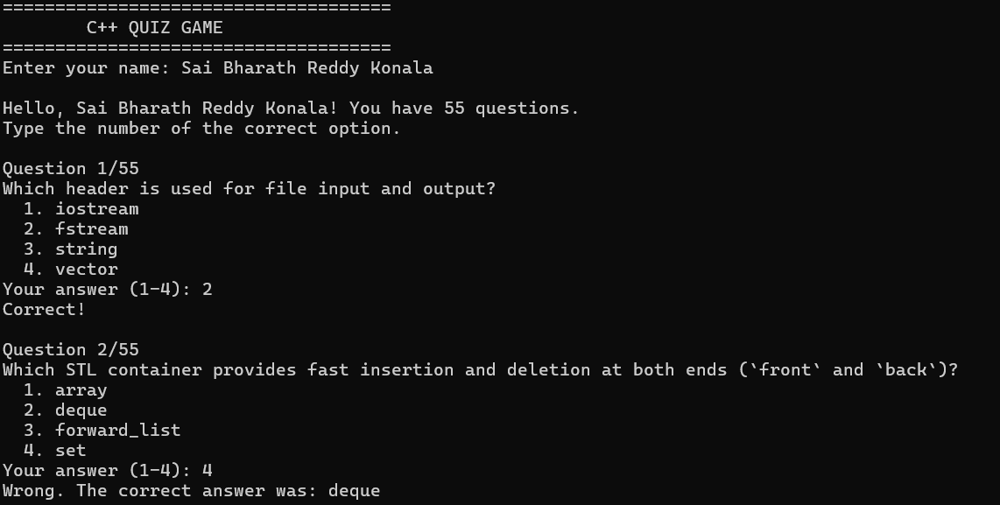
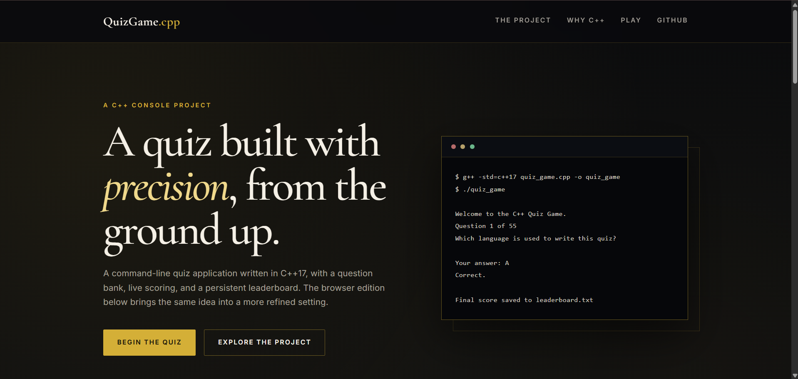

# C++ Quiz Game

A console quiz game that loads questions from a text file, tracks your score, and saves results to a leaderboard.

## Live Demo

[Play the C++ Quiz Game](https://saibharathreddykonala2558.github.io/quiz-game-system/)

## Screenshots

### C++ Console Game



### Browser Quiz



## Files

- `quiz_game.cpp` - the full source code
- `questions.txt` - questions in the format: question|option1|option2|option3|option4|correctNumber
- `leaderboard.txt` - created automatically after the first game

## Compile and run

### Windows (MinGW / g++)

```bash
g++ -std=c++17 quiz_game.cpp -o quiz_game
quiz_game.exe
```

### macOS / Linux

```bash
g++ -std=c++17 quiz_game.cpp -o quiz_game
./quiz_game
```

## Add your own questions

Open `questions.txt` and add one question per line:

```text
Question text|Option 1|Option 2|Option 3|Option 4|Correct option number
```

The correct option number must be 1, 2, 3, or 4.

## Push to GitHub

```bash
git init
git add .
git commit -m "Build C++ quiz game from scratch"
git branch -M main
git remote add origin https://github.com/YOUR_USERNAME/quiz-game.git
git push -u origin main
```
